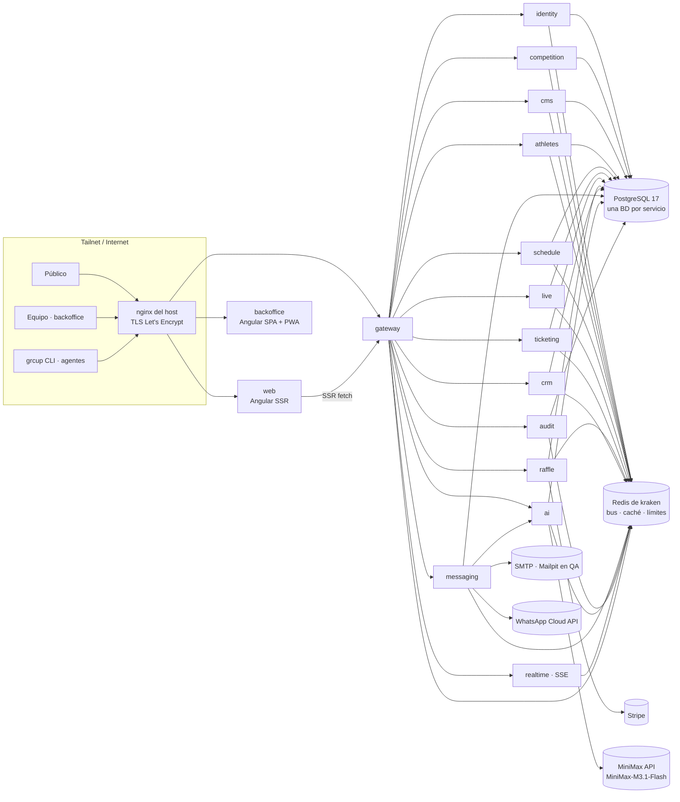
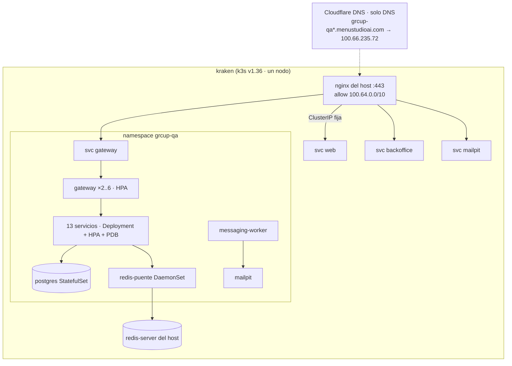

# Arquitectura · GR Cup Platform (v8)

_29/10/2026 · sustituye progresivamente a `backend/` (.NET 8 + MySQL), `frontend/` (Preact) y `backoffice/` (React). El sistema actual sigue en producción sin cambios hasta el corte (PR 16)._

Lo que hay que construir sale de tres fuentes:

- el inventario de [`INVENTARIO.md`](INVENTARIO.md): 174 endpoints actuales (118 migran, 43 se retiran y 13 están por decidir), 33 entidades, y 70 tablas, 150 endpoints únicos (172 filas de anotación) y 28 eventos del diseño v7;
- el diseño de Figma «GRSCup 2026 - UI Kit & Rutas»: 66 páginas, 47 de web pública y 19 de backoffice;
- el plan de CLI (`PLAN-CLI-BACKOFFICE.md`).

## 1. Vista general



**Principios:**

1. **Un servicio por contexto de negocio y una base de datos por servicio.** Las referencias entre servicios son por UUID, sin claves foráneas cruzadas, y nadie lee la base de datos de otro.
2. **Contrato primero.** Cada servicio publica su OpenAPI 3.1, generado desde los tipos de Go con huma. El `gateway` agrega todos en `/openapi/v1.json`, del que se generan los clientes Angular y la CLI `grcup` (paridad del plan de CLI).
3. **Eventos para todo lo que cambia.**
   - Cada mutación escribe en la tabla `outbox` del servicio dentro de la misma transacción.
   - Un *relay* la publica en Redis Streams (`grcup:events`).
   - De ahí se alimentan la auditoría, el tiempo real (SSE), los KPIs, las cachés y las reacciones entre servicios (por ejemplo, `entrada.creada` → email de confirmación).
4. **Rutas estables.** Se conservan las rutas públicas y de administración del contrato v7:
   - `/api/competiciones/{slug}/…`
   - `/api/admin/competiciones/{cid}/…`
   - `/api/auth/…`

   El `gateway` enruta por prefijo. Los clientes no saben qué servicio les responde.
5. **Multi-competición desde el principio.** Todo cuelga de `competition_id` (GR Cup, FER Cup…). Los módulos de cada competición los controla `competition`.
6. **Sin estado en los pods.** El estado vive en PostgreSQL y Redis, lo que permite escalar horizontalmente con HPA y reiniciar cualquier pod sin pérdida.

## 2. Servicios

| Servicio | Dueño de | Expone | Consume eventos |
|---|---|---|---|
| `gateway` | Tabla de rutas, límites | Todo `/api/*` (proxy), `/openapi/v1.json`, búsqueda federada `⌘K`, `/api/health` | — |
| `identity` | Usuarios, sesiones, refresh tokens, enlaces mágicos, flujo de dispositivo, tokens personales, roles, permisos (17 claves), membresías, invitaciones, vistas guardadas y preferencias | `/api/auth/*`, `/api/admin/me/*`, `/.well-known/jwks.json`, `/api/competition/{cid}/users\|roles`, `C/equipo/*` | `competition.creada` (roles por defecto) |
| `competition` | Competiciones, evento (fecha, sede, puertas, aforo del pabellón), estado programable, módulos, checklist de puesta en marcha, inscripción externa AEP, cómo llegar, integraciones cifradas (SMTP, Stripe, WhatsApp, Bunny) | `/api/competiciones/{slug}`, `/api/admin/competiciones…`, `/api/admin/workspaces…`, `C/estado`, `C/checklist`, `C/integraciones` | `*` de checklist (marca pasos automáticamente) |
| `cms` | Secciones de la home (borrador/publicado), FAQ, patrocinadores, SEO y redirecciones, blog, galería, textos legales versionados, voluntarios, medios con punto focal, ayuda (tutoriales) | `/api/competiciones/{slug}/web`, `/api/sitemap`, `C/web/*`, `C/legal/*`, `C/voluntarios`, `C/medios` | — |
| `athletes` | Perfiles de atleta, importación del acta AEP (xlsx), pesaje, openers, acreditación por QR, área del atleta, seguidores | `/api/competiciones/{slug}/atletas`, `C/atletas/*` | `horarios.publicados` (aviso al atleta) |
| `schedule` | Flights, asignación de atletas, versiones de horario (borrador, publicado, diff), generador | `/api/competiciones/{slug}/horarios`, `C/horarios/*` | `atleta.*` (conflictos) |
| `live` | Estado de plataforma, intentos, votos de jueces (Idempotency-Key + secuencia), correcciones auditadas, resultados (IPF GL), récords, acta PDF, token de pantalla | `/api/competiciones/{slug}/directo\|resultados`, `C/directo/*`, `C/resultados/*`, rutas de jueces actuales | `horarios.publicados`, `atleta.pesaje` |
| `ticketing` | Sesiones con aforo y ventana, entradas con QR `E:{c}:{id}:{hmac}`, reservas con bloqueo de fila (sin sobreventa), lista de espera con autopromoción, puestos y escaneos (lote offline idempotente) | `/api/competiciones/{slug}/entradas`, `/api/mi-entrada/*`, `C/entradas/*`, `C/checkin/*` | `evento.estado` |
| `raffle` | Configuración, premios, checklist legal (bloquea la venta), compras con Stripe Checkout, boletos, reembolsos, sorteo auditable (lista congelada y semilla publicada) | `/api/competiciones/{slug}/rifa`, `/api/webhooks/stripe`, `C/rifa/*` | — |
| `crm` | Contactos, consentimientos por finalidad y canal (con prueba), doble opt-in, segmentos, supresiones, RGPD (acceso, rectificación, supresión, anonimización programada) | `C/contactos/*`, `C/segmentos/*`, `C/supresiones/*`, `/api/baja/{token}` | `entrada.creada`, `rifa.compra`, `atleta.seguido` (alta de contacto con su consentimiento) |
| `messaging` | Campañas email + WhatsApp con diseño único (HTML Tailwind → email compilado + texto WhatsApp), revisiones, operaciones del editor, plantillas transaccionales, plantillas de Meta, automatizaciones, outbox de mensajes con reintentos y *circuit breaker*, webhooks de WhatsApp. Un *worker* aparte envía | `C/campanas/*`, `C/emails/*`, `C/whatsapp/*`, `C/mensajes/*`, `C/automatizaciones/*`, `/api/webhooks/whatsapp` | `entrada.creada`, `rifa.compra`, `horarios.publicados`… (emails transaccionales) |
| `ai` | Pasarela única a MiniMax: asistente del editor (devuelve operaciones), acortar a WhatsApp, metadatos SEO y borradores de FAQ. Registro de uso y presupuesto por competición. Nunca recibe datos personales | Interno: `/internal/ai/*`; vía gateway: `C/campanas/ia/*`, `C/web/seo/sugerir` | — |
| `realtime` | Conexiones SSE: público por slug, admin filtrado por permisos, pantalla con token | `/api/competiciones/{slug}/stream`, `C/stream`, `/api/pantalla/{slug}/stream` | `*` |
| `audit` | Registro de auditoría (quién, qué, diff, origen web/cli/mcp/token), actividad, notificaciones, KPIs y series del Inicio, exportaciones y estado de trabajos | `C/auditoria`, `C/actividad`, `C/dashboard*`, `C/notificaciones`, `C/exportaciones`, `C/trabajos` | `*` |

Cada endpoint y tabla con su servicio: [`INVENTARIO.md`](INVENTARIO.md).

## 3. Stack de backend (Go)

| Pieza | Elección | Motivo |
|---|---|---|
| Lenguaje | Go 1.26, **un único módulo** `github.com/jaivial/grweb/platform` con un `cmd/` por servicio | Código compartido sin publicar paquetes; cada servicio sigue siendo su propia imagen y despliegue |
| HTTP | `net/http` (ServeMux con patrones de Go 1.22+) + **huma v2** | OpenAPI 3.1 y validación desde los tipos, errores RFC 9457 (problem+json) con `code` estable |
| PostgreSQL | **pgx v5** (pool, `RowToStructByName`) + **goose** con migraciones SQL embebidas | Sin ORM ni generadores; las migraciones se aplican en el `initContainer` (`<svc> migrate`) con *advisory lock* |
| Claves | UUIDv7 | Ordenables por tiempo, válidas entre servicios y para la CLI |
| Redis | go-redis v9, compatible con **Redis 6.0** (el de kraken) | Sin `XAUTOCLAIM`, `GETDEL` ni `SET … GET`; reclamo de pendientes con `XPENDING` + `XCLAIM` |
| Bus | Outbox transaccional → `XADD grcup:events MAXLEN ~ 200000`, un *consumer group* por servicio consumidor y tabla `processed_events` (idempotencia) | Entrega al menos una vez, consumidores idempotentes y repetición con `XRANGE` para `Last-Event-ID` |
| Autenticación | `identity` firma JWT **ES256** (con `kid` y JWKS): acceso de 15 min con permisos por competición; refresco rotatorio (cookie httpOnly en web, cuerpo en CLI); lista de revocación en Redis | `gateway` y cada servicio verifican con el JWKS en caché, sin confianza implícita |
| Llamadas internas | HTTP/JSON con token de servicio (HS256, `aud` = servicio destino) + NetworkPolicies | Simple y auditable |
| Contraseñas | argon2id + límite de intentos en Redis | — |
| Secretos de integraciones | AES-256-GCM con la clave del Secret `grcup-crypto` | La API nunca devuelve el secreto (`••••1234`) |
| Logs y métricas | `log/slog` en JSON con `request_id`, `/metrics` en formato Prometheus, `/healthz` y `/readyz` | — |
| Ficheros | Medios en volumen (QA) o BunnyCDN (producción), detrás de una interfaz `Storage` | — |
| PDF / xlsx | `go-pdf/fpdf` (acta, entrada imprimible), `excelize` (acta AEP) | — |
| Email | Compilación Tailwind con el binario standalone de Tailwind v4 + `go-premailer` (CSS en línea) | El mismo diseño sirve para el editor, la previsualización y el envío |

**Estructura:**

```
platform/
  go.mod                     # módulo único
  cmd/<servicio>/main.go     # un binario por servicio
  internal/<servicio>/       # dominio, http, store, eventos, migraciones (embed)
  pkg/                       # compartido: app, httpx, problem, db, redisx, events, auth, idem, ratelimit, sse, crypto, mailer
  web/                       # workspace Angular (pnpm)
  deploy/k8s/                # kustomize: base/ + overlays/qa/
  deploy/scripts/            # build-imagenes, desplegar-qa, dns-cloudflare, nginx-qa
  docs/                      # este documento, INVENTARIO, ROADMAP, runbooks
  Dockerfile                 # multi-stage; ARG SVC → imagen distroless por servicio
  Makefile                   # verify (vet + build + ng build), images, deploy-qa
```

## 4. Base de datos

- **PostgreSQL 17**: en QA, un StatefulSet propio dentro del clúster (volumen hostPath `/var/lib/grcup-qa/postgres`). El PostgreSQL de kraken no se toca porque da servicio a producción. Hay una base de datos y un rol por servicio (`grcup_identity`, `grcup_ticketing`…), y el rol de cada servicio solo tiene permisos sobre la suya.
- **Convenciones:**
  - nombres en `snake_case` y en español, como el dominio;
  - `id uuid` como clave primaria;
  - `competition_id uuid` en todo lo que pertenece a una competición;
  - `created_at`, `updated_at` y `version int` (ETag e `If-Match` → 409 `CONFLICTO_EDICION`).
- **Tablas comunes a todos los servicios:**
  - `outbox (id, topic, key, payload jsonb, created_at, published_at)`;
  - `processed_events (consumer, event_id)`;
  - `idempotency` en Redis, con la respuesta guardada 24 h.
- **Datos personales:**
  - emails y teléfonos con `citext` y un *hash* para buscar duplicados;
  - anonimización programada por `crm`: se proponen 12 meses tras el evento, pendiente de asesoría;
  - los logs nunca incluyen datos personales.
- **Mapeo del modelo actual:** el inventario indica, para cada entidad EF y cada tabla v7, el servicio que la recibe. Las tablas del diseño v7 en PascalCase/MySQL pasan a `snake_case`/PostgreSQL. El ETL del legado se hace en el PR 16 y nunca copia datos personales de producción a QA.

## 5. Redis (el de kraken)

Se reutiliza `redis-server` 6.0.16 de kraken (127.0.0.1:6379; hoy está sin claves y con un solo cliente):

- **Acceso desde los pods.** Un DaemonSet `redis-puente` con `hostNetwork` (socat) escucha en `10.42.0.1:16379` (cni0, no expuesto a internet) y reenvía a `127.0.0.1:6379`. El Service `redis` del namespace apunta ahí. Así no se reconfigura ni se reinicia el Redis de producción.
- **Aislamiento.**
  - Usuario ACL `grcup` con permisos solo sobre las claves `~grcup:*` (en `redis.conf` y en caliente con `ACL SETUSER`, sin reiniciar).
  - Todas las claves y canales llevan el prefijo `grcup:<entorno>:`.
- **Usos:**
  - bus de eventos (Streams);
  - caché de lecturas públicas (home, horarios, resultados), invalidada por eventos;
  - límites de peticiones;
  - claves de idempotencia;
  - bloqueos de *workers* (`SET NX PX`);
  - revocación de tokens;
  - presencia en directo;
  - contadores en vivo del aforo.
- **Límites.** Streams con `MAXLEN ~`, TTL en todas las claves de caché y un objetivo de menos de 256 MB. La política `noeviction` del Redis de kraken obliga a vigilarlo; `audit` lo comprueba en la página de salud.

## 6. Frontend (Angular)

| Pieza | Elección |
|---|---|
| Framework | **Angular** (última versión estable) con componentes *standalone*, **signals**, *zoneless*, control de flujo `@if/@for` y `@defer` |
| Estilos | **Tailwind CSS v4** (`@theme` con los tokens de Figma: colores `bg/*`, `line/*`, `brand/accent*`, espaciado `space/*`, radios `radius/*`, tipografías Contrail One, Inter y Roboto Mono) + capa de grano |
| Workspace | Angular CLI multiproyecto con **pnpm**: `projects/ui` (librería del sistema de diseño), `projects/web` (web pública), `projects/backoffice` |
| Web pública | **SSR + prerender** (`@angular/ssr`) con hidratación incremental para el SEO del plan SEO. Rutas de las páginas 05–45 de Figma. i18n es/en. Animación del trofeo con *frames* del CDN en `<canvas>` |
| Backoffice | SPA + **PWA** (`@angular/service-worker`): check-in sin red con IndexedDB (Dexie), cámara QR (`BarcodeDetector` con *fallback* `@zxing/browser`) |
| Datos | Cliente tipado generado del OpenAPI del gateway (`ng-openapi-gen`), `httpResource`/`resource` con signals, `@ngrx/signals` para los estados complejos (editor de campañas, mesa de directo, check-in) |
| Interacción | **Angular CDK**: diálogos, overlays, drag & drop (planificador de horarios, capas del editor), a11y, virtual scroll en tablas largas |
| Iconos y gráficos | `lucide-angular`; minigráficas SVG propias; Chart.js solo donde haga falta |
| Tiempo real | Servicio `EventSource` → signals, con reconexión y `Last-Event-ID` |
| Calidad | `angular-eslint` + Prettier + `ng build` estricto (`strictTemplates`) |
| Imágenes Docker | `web`: Node (servidor SSR); `backoffice`: `nginx-unprivileged` con estáticos |

**Fidelidad al diseño:**
- **Componentes.** Los de `projects/ui` reproducen los *component sets* de Figma (páginas 02, 03, 48–50, incluidos los 11 del editor de campañas v7.1) con las mismas variantes y medidas del sistema dimensional v7:
  - rejilla de 4 pt;
  - controles de 44 px en móvil y de 40 px en el escritorio denso;
  - anchos estables entre estados.
- **Pantallas.** Cada pantalla se implementa sobre su frame de Figma y se revisa con `cu` en los tres puntos de corte: D 1440, T 768 y M 390.

## 7. Despliegue: Docker + Kubernetes (k3s de kraken)



- **Imágenes.**
  - Dockerfile multi-stage: build con `golang:1.26` → `gcr.io/distroless/static:nonroot`, de unos 15 MB por servicio.
  - Se etiquetan con el commit.
  - No hay registro: se construyen en el escritorio y se importan en containerd de k3s (`docker save | ssh kraken sudo k3s ctr -n k8s.io images import -`), con `imagePullPolicy: IfNotPresent`.
- **Manifiestos.** Kustomize: `base/` (un directorio por servicio) y `overlays/qa/`. Cada servicio tiene:
  - **Deployment** con `initContainer migrate`, *probes* y `securityContext` sin privilegios: `runAsNonRoot`, `readOnlyRootFilesystem`, sin *capabilities*.
  - **Service ClusterIP.** El `gateway`, la `web`, el `backoffice` y `mailpit` usan una IP fija del rango 10.43.240.0/24 para el nginx del host. **Sin NodePort**, porque kraken no tiene cortafuegos.
  - **HPA** (CPU 70 % y memoria 80 %, con metrics-server de k3s): mínimo 1 o 2 réplicas y máximo de 4 a 6 según el servicio.
  - **PodDisruptionBudget**.
  - **NetworkPolicy** (kube-router está activo): todo cerrado salvo nginx → web, backoffice y gateway; gateway → servicios; servicio → servicio según el grafo; DNS; PostgreSQL; el puente de Redis; y salida a MiniMax, SMTP, Stripe y Meta.
  - **Límites por namespace** con ResourceQuota y LimitRange.
- **Balanceo.** Lo hace kube-proxy entre réplicas. El escalado automático lo hace el HPA, y los *workers* coordinan con bloqueos en Redis. `realtime` aguanta conexiones largas con *keep-alive* de 15 s. El escalado es horizontal porque todas las réplicas leen del mismo Stream.
- **Secretos:**
  - `grcup-db` (contraseñas por servicio);
  - `grcup-jwt` (clave ES256);
  - `grcup-internal`;
  - `grcup-crypto`;
  - `grcup-redis` (contraseña del usuario ACL);
  - `grcup-ai` (MiniMax).

  Se crean desde el escritorio por stdin y nunca se guardan en el repo.

## 8. QA por la tailnet

**Subdominios** (registro A a la IP de tailnet de kraken `100.66.235.72`, en Cloudflare solo DNS):

| Subdominio | Sirve |
|---|---|
| `grcup-qa.menustudioai.com` | Web pública |
| `grcup-qa-bo.menustudioai.com` | Backoffice |
| `grcup-qa-api.menustudioai.com` | Gateway (CLI y agentes) |
| `grcup-qa-mail.menustudioai.com` | Mailpit (emails enviados en QA) |

**Acceso:**
- **TLS.** certbot con `dns-cloudflare`, como el resto de subdominios de kraken.
- **Solo tailnet.** El nginx del host acepta únicamente `100.64.0.0/10`; la web y el backoffice reenvían `/api/` al gateway desde su mismo origen (sin CORS y con cookies `SameSite=Strict`).
- **Datos:** sintéticos («Datos de ejemplo»). Nunca se copian datos personales de producción.

**Integraciones externas en QA:**
- **Email:** Mailpit.
- **WhatsApp y Stripe:** proveedores simulados mientras no haya credenciales de prueba.
- **MiniMax:** el real, con la clave de `~/.env`.

**Verificación de cada PR:** `make verify` (`go vet`, `go build`, `ng build`, `kustomize build`), despliegue en `grcup-qa` y recorrido con `cu` de las pantallas afectadas en escritorio y móvil. Por la regla del proyecto no se escriben tests.

## 9. IA (MiniMax)

- **Conexión.** API compatible con Anthropic en `https://api.minimax.io/anthropic/v1/messages`, modelo **`MiniMax-M3.1-Flash`** y clave `MINIMAX_TOKEN_PLAN_API_KEY` en el Secret `grcup-ai`. Las respuestas traen bloques `thinking`, que se descartan, y `text`.
- **Usos:**
  - asistente del editor de campañas: instrucción → lista de operaciones sobre las capas, con diff y deshacer;
  - acortar el texto a WhatsApp;
  - metadatos SEO;
  - borradores de FAQ y de textos de la web.
- **Garantías:**
  - salida JSON validada contra un esquema;
  - reintentos;
  - presupuesto mensual por competición en Redis;
  - registro de cada llamada en `ai_peticiones` (tokens, coste y duración);
  - **sin datos personales**: solo plantillas, textos y recuentos, como en newvillacarmen.

## 10. Seguridad

- **Permisos.** El JWT lleva solo lo necesario: `sub`, `comp: {cid: [permisos]}`, `origen` y `jti`. Los permisos se comprueban en cada servicio con `RequirePermission("entradas.editar")`.
- **Auditoría.** Toda mutación genera un evento con el actor, el origen (web, cli, mcp o `token:<nombre>`), el diff y el `request_id`, y `audit` lo guarda.
- **Límites de peticiones:** el login y la reserva pública por IP y email; las APIs públicas por IP. Las respuestas de error no filtran información.
- **QR de entradas.** Firma HMAC por competición: el check-in sin red verifica con la clave descargada en el *bootstrap* del puesto.
- **Webhooks.** Firma de Stripe y Meta verificada, eventos guardados de forma idempotente y reintento desde el backoffice.
- **Cumplimiento legal y RGPD** (para revisión de la asesoría):
  - consentimiento separado y sin premarcar para email y WhatsApp;
  - doble opt-in;
  - menores con autorización;
  - el sorteo de pago se bloquea hasta completar la checklist legal.

## 11. Fuera de la primera entrega

- **Web pública de `ferweb` (FER Cup):** se soporta como tenant, pero su frontend llegará después.
- **Cupones y referidos (10 endpoints):** pendientes de decisión, porque dependen del formulario de inscripción propio, que se retira.
- **Corte a producción:** el PR 16 deja el ETL y el plan de corte. El despliegue en producción necesita aprobación expresa.
